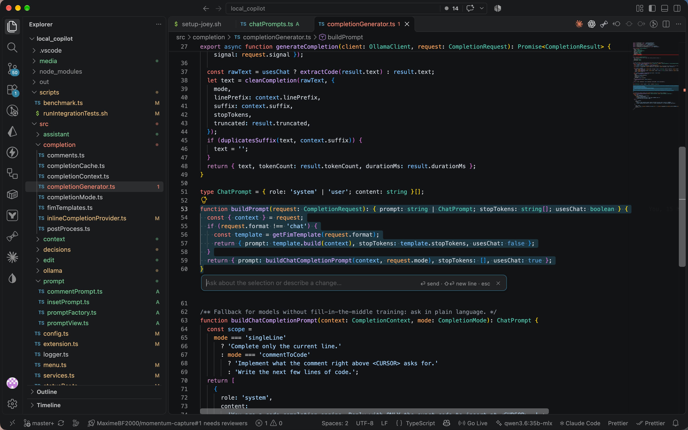
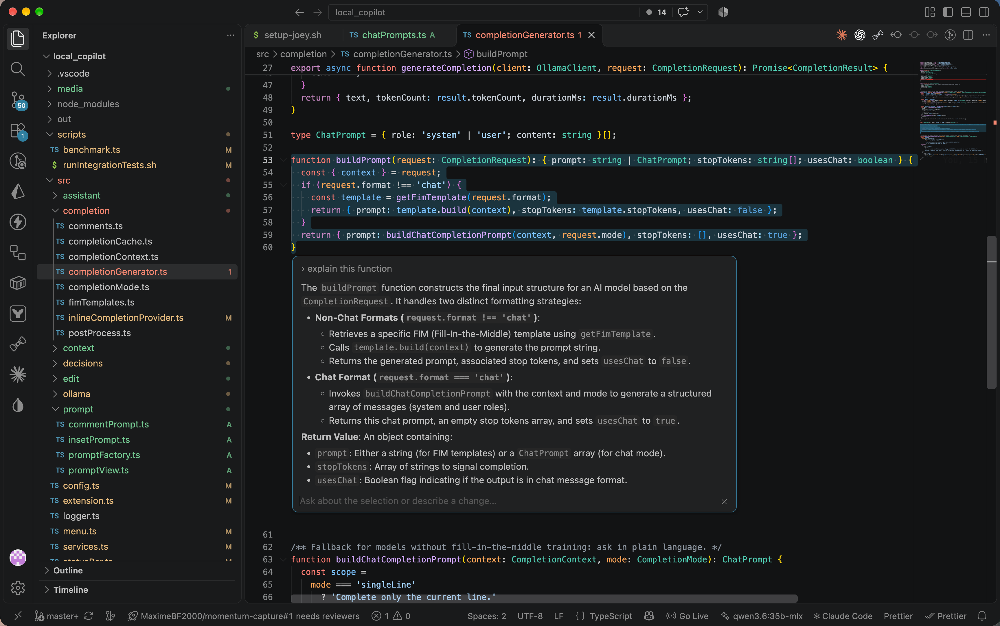
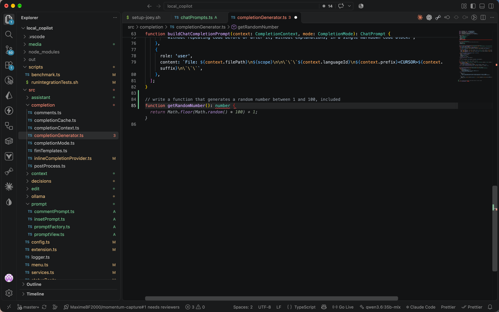

# Local Copilot

Copilot-style inline autocomplete and Cursor-style AI prompts (`Cmd+J`, `Cmd+Shift+J`) for VS Code, powered entirely by **local Ollama models**. No cloud, no API keys, no telemetry.





| Feature | How |
| --- | --- |
| **Inline autocomplete** (single and multiline) | Just type. Ghost text appears after a short pause. `Tab` accepts, `Esc` or typing on dismisses. `Alt+\` asks explicitly. |
| **Comment → code** | Write a comment like `// Create a function that validates an email`, press `Enter`: the implementation appears as ghost text. |
| **Inline prompt** (`Cmd+J`) | Select code, or just place the cursor, and press `Cmd+J`. A compact, focused prompt opens right below it. **Ask** ("explain this function") and the answer appears in the prompt, where you can keep the conversation going. **Request a change** ("add error handling") and the selection, line or enclosing function is rewritten directly in the file. `Enter` sends, `Shift+Enter` adds a new line, `Esc` closes. |
| **File prompt** (`Cmd+Shift+J`) | The same compact prompt, centered at the bottom of the editor, for the whole file. Questions are answered there. Change requests are applied straight to the file, touching only the lines that change. |

Changes are applied directly, with no accept/reject step. Every change is a single edit, so **`Cmd+Z` undoes it in one step**, and the changed lines flash briefly so you can see what moved. Whether a prompt is a question or a change request is decided automatically by the [clef-flash](https://ollama.com/library/clef-flash) decision model (see below).

## Requirements

- [Ollama](https://ollama.com) running locally (default `http://localhost:11434`).
- A code model. The default is `qwen3.6:35b-mlx`. Any installed Ollama model can be chosen with **Local Copilot: Select Model**, or by clicking the status bar item.

## Measured performance

Measured on a MacBook Pro M5 Max with `qwen3.6:35b-mlx` (MLX, NVFP4). Run `npm run benchmark` to reproduce.

| Task | Latency |
| --- | --- |
| Single-line / short completion | **50–100 ms** model time |
| Comment → function (5–25 lines) | 250–900 ms |
| Cmd+J inline edit (10-line function) | ~0.5 s |
| Cmd+Shift+J file refactor (25-line file) | ~1.2 s |
| clef-flash decision (answer vs edit) | ~80 ms |

## Models

All models are configurable. Settings are under `localCopilot.*`. The status bar menu covers the common ones.

| Setting | Default | Role |
| --- | --- | --- |
| `localCopilot.model` | `qwen3.6:35b-mlx` | Autocomplete, and edits unless overridden |
| `localCopilot.editModel` | *(same as model)* | Cmd+J / Cmd+Shift+J answers and edits |
| `localCopilot.decision.model` | `clef-flash` | Prompt decisions (see below) |

**Prompt formats.** Autocomplete uses the model's *fill-in-the-middle* tokens, which makes it fast and context-aware. The format is detected from the model name (Qwen, DeepSeek-Coder, CodeLlama, StarCoder, CodeGemma). Models without fill-in-the-middle fall back to a slower instruction prompt. You can force a format with `localCopilot.autocomplete.promptFormat`.

## The decision engine

The assistant asks itself a few small questions while it works:

| Question | Answered by | Why |
| --- | --- | --- |
| Is the prompt a question or a change request? | **clef-flash** | Ties the rules on plain English (17/18 each), but gets 12/12 on other languages and unusual phrasing, where the rules get 8/12 |
| Without a selection: edit the current line or the whole function? | **clef-flash** | Depends on the meaning of the instruction |
| Would an autocomplete suggestion help here? | rules | Runs on every typing pause, so it must cost ~0 ms |
| Does this comment ask for code? | rules | Rules 13/14 vs clef-flash 12/14, and instant |

A decision takes about 80 ms on an M5 Max. Running one in parallel with a Qwen completion didn't slow the completion down (282 ms vs 278 ms median).

When `decision.engine` is `rules`, or when the model is not installed or doesn't answer within `decision.timeoutMs` (1.5 s by default), every question falls back to the rules. The status bar tooltip shows which engine is active.

### Installing clef-flash

[clef-flash](https://ollama.com/library/clef-flash) is a 9B decision model (fine-tuned from Qwen3.5-9B). Install it with:

```bash
ollama pull clef-flash
```

The extension uses Ollama's native decision API (`POST /v1/systemone`). It sends a short description of the situation (the "state") and a multiple-choice question, and gets back the chosen option with its probability. The questions live in `src/decisions/decisionQuestions.ts`. Any Ollama model with the `decision` capability works; pick one with **Local Copilot: Select Decision Model**.

## Enable the compact prompt (one-time)

The compact prompt is embedded in the editor through VS Code's `editorInsets` API. It's a *proposed* API, which VS Code only allows after a one-time opt-in:

1. Run **Preferences: Configure Runtime Arguments** (this opens `~/.vscode/argv.json`).
2. Add `"enable-proposed-api": ["local.local-copilot"]`.
3. Quit and restart VS Code.

Without this, the prompts still work, but in VS Code's comment widget below the line. It's larger and sends with `Cmd+Enter` instead of `Enter`.

## Smart context

Prompts (Cmd+J and Cmd+Shift+J) always include the active file's code: the target, plus the surrounding lines or the whole file. They also include the **definitions of the functions, types and variables that code uses**:

1. Every symbol in the target code is looked up with your language server's *Go to Definition*. TypeScript, Svelte, Python, Go… whatever you have installed, so imports are resolved across files and through aliases.
2. Only the declaration itself is extracted (the function, class, interface or type), not the whole file.
3. Definitions inside the target itself and in `node_modules` are skipped. The rest are added in order of first use, up to `localCopilot.context.maxDefinitionChars` (12,000 characters, about 3k tokens).

The model sees exactly the signatures and types the code depends on, at a fraction of the cost of pasting entire files. Turn it off with `localCopilot.context.definitions`.

## How it works

```
VS Code ──► Orchestrator (TypeScript)
              ├─ collect context (code around cursor + imports / target code or file + definitions of the symbols it uses)
              ├─ decisions: rules (autocomplete) · clef-flash (prompts: answer vs edit, edit scope)
              └─ Ollama (local HTTP)
                    ├─ autocomplete: raw fill-in-the-middle prompt
                    ├─ answers: streamed chat, rendered as markdown
                    └─ edits: replacement code / SEARCH-REPLACE blocks
VS Code ◄── ghost text · compact prompt (answers) · direct edits (Cmd+Z to undo)
```

Autocomplete keeps the UI responsive:

- **Debounce.** Waits for a 75 ms typing pause.
- **Cancellation.** Every keystroke cancels the outstanding request and aborts the HTTP call, so Ollama stops generating.
- **Cache.** Recent suggestions are reused, including while you "type through" a suggestion.
- **Small context.** 120 lines before the cursor and 40 after, plus the file's imports when the top is cut off.
- **Scoped output.** Single-line mode stops at the first newline. Multiline mode stops when the code leaves the current block, and drops lines that already exist after the cursor.
- **No overlap.** Autocomplete pauses in a file while a prompt is rewriting it.

Edits never overwrite newer work: if the target code (Cmd+J) or the file (Cmd+Shift+J) changed while the model was generating, the result is discarded.

**File edits.** The model answers with SEARCH/REPLACE blocks, which is fast because only the changed parts are generated. If a block doesn't match the file, the extension falls back to asking for the whole file. Either way, only the lines that actually differ are replaced.

**UI.** Both prompts are a small card embedded between two lines of the editor (proposed `editorInsets` API, see above):
- **Cmd+J** places it below the cursor or selection, aligned with the code.
- **Cmd+Shift+J** places it at the bottom of the visible code, centered.

The card follows your color theme. It's one line tall until an answer needs more room, then grows to fit (up to 26 lines, scrolling after that). Without the opt-in, VS Code's comment widget is used instead.

## Commands and shortcuts

| Command | Shortcut |
| --- | --- |
| Local Copilot: Inline Prompt (Ask or Edit) | `Cmd+J` (`Ctrl+J`) |
| Local Copilot: File Prompt (Ask or Edit) | `Cmd+Shift+J` (`Ctrl+Shift+J`) |
| Send / new line / stop or close (in a prompt) | `Enter` / `Shift+Enter` / `Esc` |
| Select Model / Select Edit Model / Select Decision Model | — |
| Change Keyboard Shortcuts | opens the shortcut editor filtered to Local Copilot |
| Toggle Autocomplete · Show Menu · Show Logs | click the status bar item |

> Both shortcuts can be changed: run **Local Copilot: Change Keyboard Shortcuts** (also in the status bar menu) and set new keys for *Inline Prompt (Ask or Edit)* and *File Prompt (Ask or Edit)*. Inside a text editor, `Cmd+J` replaces VS Code's default "Toggle Panel" binding; it still works everywhere else.

## Development

```bash
npm install
npm test                  # unit tests (no VS Code, no Ollama)
npm run benchmark         # latency / quality against your local Ollama
npm run test:integration  # runs inside a hidden, isolated VS Code instance (needs Ollama)
npm run package           # builds local-copilot-<version>.vsix
```

Press `F5` in VS Code to launch an Extension Development Host. Enable `localCopilot.debugLogging` to see timings for every request in the **Local Copilot** output channel.

### Code map

```
src/
  extension.ts               wiring: providers, commands, settings changes, model warm-up
  config.ts                  typed settings
  services.ts                shared Ollama client + decision engine (rebuilt on settings change)
  statusBar.ts · menu.ts · logger.ts
  ollama/
    ollamaClient.ts          raw generate (FIM), streaming chat, next-token probabilities, list models
    modelPicker.ts           quick pick over installed models
  completion/                autocomplete
    inlineCompletionProvider.ts   VS Code provider: debounce, cache, cancellation, decisions
    completionGenerator.ts        prompt → Ollama → cleaned suggestion
    completionContext.ts · completionMode.ts · comments.ts · fimTemplates.ts · postProcess.ts · completionCache.ts
  decisions/
    decisionEngine.ts        interface + rules engine
    rules.ts                 the heuristics (incl. answer-vs-edit)
    modelDecisionEngine.ts   decision model (clef-flash) through Ollama's decision API, rules fallback
    decisionQuestions.ts     the multiple-choice questions sent to the decision model
  prompt/                    UI
    promptView.ts            the interface both prompt implementations follow
    insetPrompt.ts           compact card embedded in the editor (media/prompt.css + prompt.js)
    commentPrompt.ts         fallback: VS Code's comment widget
    promptFactory.ts         picks the implementation, one open prompt at a time
  context/
    definitions.ts           definitions of used symbols via the language server
    identifiers.ts           which identifiers to resolve
    promptContext.ts         formats them for prompts
  assistant/                 orchestration
    inlineAssistant.ts       Cmd+J: decide → answer in the prompt or edit in place
    fileAssistant.ts         Cmd+Shift+J: decide → answer in the prompt or edit the file
    chatPrompts.ts · streamAnswer.ts
  edit/
    generateEdits.ts         model calls for inline replacements and file edits
    applyChanges.ts          direct, single-undo edits + flash highlight
    editTarget.ts            selection / line / enclosing function / question context
    editBlocks.ts · editPrompts.ts · codeExtraction.ts · textRegion.ts · targetHighlight.ts
scripts/
  benchmark.ts · runIntegrationTests.sh
```
